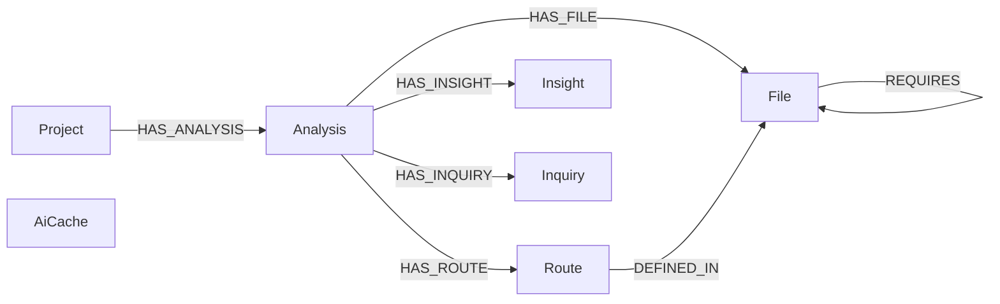
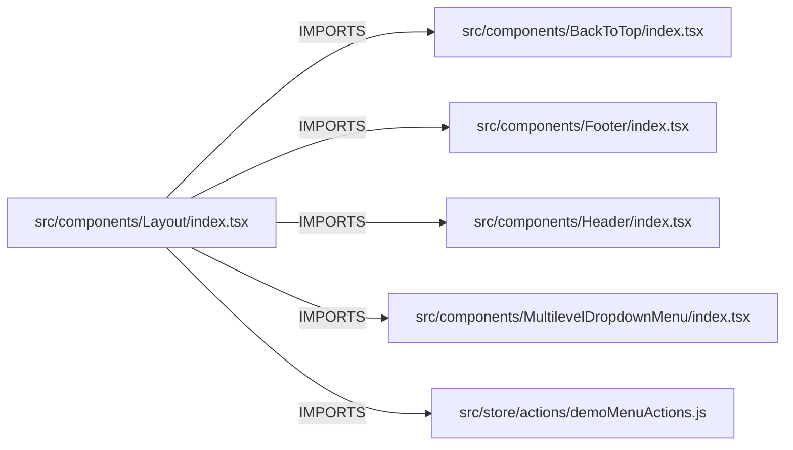

[](https://youtu.be/hz-TFz4LJ4I)

The image below is a YouTube video. Click it to watch the demo.

[](https://youtu.be/hz-TFz4LJ4I)

# Graph Verse

Paste a public TypeScript or JavaScript repository and Graph Verse draws it as a dependency map. Every box and every line comes from parsing the code. FalkorDB stores that map, one graph per Clerk organization, and every lookup — neighbours, blast radius, routes, the agent — is a fixed OpenCypher query over those relationships.

## The graph



`AiCache` sits in the same organization graph with no edges. Unresolved imports are counted on the analysis and never become relationships.

### Nodes

| Label | What it is | Properties |
| --- | --- | --- |
| `Project` | A public GitHub repository | `id`, `repoOwner`, `repoName`, `createdAt` |
| `Analysis` | One parse of that repository | `id`, `status`, `stage`, `stageMessage`, `commitSha`, `framework`, `coverage`, `importCount`, `routeCount`, `schemaVersion`, `startedAt`, `finishedAt`, `createdAt` |
| `File` | A file the parser opened, or skipped and said why | `id`, `path`, `folder`, `module`, `lines`, `bytes`, `hash`, `fanIn`, `fanOut`, `role`, `roleSource`, `exports`, `skipReason`, `skipDetail` |
| `Route` | An HTTP route recovered from the file | `id`, `method`, `path`, `line` |
| `Insight` | An explanation written from a file and its real neighbours | `id`, `body`, `createdAt` |
| `Inquiry` | A question asked of the repository, plus the paths the tools returned | `id`, `question`, `paths`, `threadId`, `createdAt` |
| `AiCache` | A cached model reply for one task | `key`, `task`, `model`, `body`, `createdAt` |

### Relationships

| Type | From | To | Meaning |
| --- | --- | --- | --- |
| `HAS_ANALYSIS` | `Project` | `Analysis` | This repository was parsed |
| `HAS_FILE` | `Analysis` | `File` | This parse produced this file |
| `HAS_ROUTE` | `Analysis` | `Route` | This parse recovered this route |
| `HAS_INSIGHT` | `Analysis` | `Insight` | An explanation stored with the parse |
| `HAS_INQUIRY` | `Analysis` | `Inquiry` | A question and the paths looked up for it |
| `DEFINED_IN` | `Route` | `File` | The route is declared in this file |
| `IMPORTS` | `File` | `File` | A resolved static import. `specifier`, `line`, `typeOnly` |
| `RE_EXPORTS` | `File` | `File` | A resolved re-export. Same properties |
| `DYNAMIC_IMPORT` | `File` | `File` | A resolved dynamic `import()`. Same properties |
| `REQUIRES` | `File` | `File` | A resolved `require()`. Same properties |

An edge exists only when the parser resolved a real import to a real file. The model never writes Cypher and never invents an edge.

## The graph does the work

`src/components/Layout/index.tsx` in `xizon/fullstack-nextjs-app-template` is the file 26 others import. What it itself imports is this query, not a guess:

```cypher
MATCH (p:Project {repoOwner: 'xizon', repoName: 'fullstack-nextjs-app-template'})
      -[:HAS_ANALYSIS]->(a:Analysis)
      -[:HAS_FILE]->(f:File {path: 'src/components/Layout/index.tsx'})
      -[r:IMPORTS|RE_EXPORTS|DYNAMIC_IMPORT|REQUIRES]->(other:File)
RETURN type(r) AS kind, other.path AS path, r.specifier AS specifier
ORDER BY path
```



The same four relationship types are what the map, the two-hop blast radius, and the agent walk. Fan-in and fan-out are counts on the `File` node. Who depends on a file, and which route is declared in which file, are Cypher.
